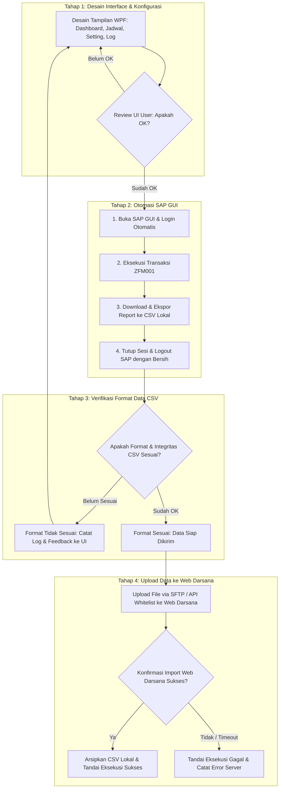

# ISSUE: Rencana Pengembangan Aplikasi Desktop Bot Atlaz (Ekstraksi Data SAP & Sinkronisasi Web Darsana)

## 1. Metadata Dokumen
- **Nama Proyek:** Atlaz
- **Deskripsi Proyek:** Windows Desktop Bot untuk Otomasi Ekstraksi SAP ZFM001 & Sinkronisasi Data ke Web Darsana (Laravel Dashboard).
- **Target Platform:** Windows Desktop (.NET 8 / WPF - MVVM).
- **Metode Pengembangan:** 4 Tahapan Bertahap (*Phase-Gated Development Roadmap*).
- **Tujuan Dokumen:** Panduan arsitektur *high-level* terstruktur untuk agen AI pelaksana agar mengimplementasikan proyek per tahap secara terkontrol.
- **Status:** Planning / Ready for Phase 1

---

## 2. Latar Belakang & Masalah

### 2.1 Kondisi Eksisting
1. Proses penarikan data anggaran harian/berkala dari SAP dilakukan melalui SAP GUI menggunakan transaksi kustom **`ZFM001`**, yang menghasilkan output berupa file CSV.
2. File CSV tersebut selanjutnya harus dikirimkan ke aplikasi web dashboard **Web Darsana** (berbasis Laravel) yang berjalan di shared hosting (Hostinger/cPanel).
3. Bot sebelumnya mengandalkan skrip PowerShell dan VBScript. Pada fase pengiriman data ke endpoint Web Darsana, bot mengalami kendala **HTTP 403 Forbidden** yang dipicu oleh proteksi Web Application Firewall (WAF) **Imunify360** pada level hosting.

### 2.2 Batasan Desain & Kebijakan Kepatuhan (Anti-Bypass Policy)
> [!IMPORTANT]
> **Kebijakan Keamanan:**
> Dilarang keras mengimplementasikan teknik *scraping*, manipulasi browser headless siluman, spoofing User-Agent/header peretas, atau trik bypass proteksi WAF Imunify360. Pengiriman data harus menggunakan jalur resmi dan terverifikasi yang didukung dan diizinkan oleh arsitektur hosting.

Aplikasi desktop baru harus memisahkan secara tegas (*strict separation of concerns*) antara:
1. **Engine Otomasi SAP GUI:** Khusus login, eksekusi transaksi ZFM001, dan ekspor CSV lokal.
2. **Engine Validasi Data:** Memeriksa kesesuaian format dan kelayakan file CSV sebelum proses kirim.
3. **Engine Transfer & Sinkronisasi:** Saluran komunikasi resmi yang telah disetujui administrator hosting Web Darsana.

---

## 3. Analisis Saluran Transfer Data ke Web Darsana (Hosting Compliant)

Sebelum menetapkan implementasi pengiriman pada Tahap 4, agen pelaksana harus merujuk pada opsi transfer legal yang didukung lingkungan Hostinger/cPanel:

| Opsi Jalur | Mekanisme Teknis | Toleransi Imunify360 | Kebutuhan Konfigurasi Server | Rekomendasi |
| :--- | :--- | :--- | :--- | :--- |
| **Opsi A: SFTP / FTPS (Terisolasi)** | File diunggah langsung ke direktori aman cPanel (`storage/app/import_staging`) via SSH.NET / FTPS dengan akun kredensial FTP terpisah. Web Darsana membaca file via cron/job worker harian. | **Sangat Aman** (Tidak melalui port 80/443 HTTP layer, sehingga tidak diinspeksi oleh WAF Imunify360 HTTP rules). | Buat akun FTP/SFTP terbatas hanya ke folder staging. Pasang Laravel Artisan command/scheduler di Web Darsana untuk memproses file masuk. | **Prioritas 1 (Sangat Disarankan)** |
| **Opsi B: REST API Resmi + IP Whitelist** | Desktop bot mengirim payload CSV/JSON melalui API endpoint berotentikasi (Laravel Sanctum token). IP publik PC kantor didaftarkan di whitelist Imunify360 cPanel. | **Aman jika di-whitelist** (Jika IP kantor statis, admin hosting dapat memasukkan IP ke *Imunify360 White List*). | Administrator memasukkan IP keluar bot ke Whitelist cPanel Imunify360 + generate API Token. | **Prioritas 2 (Alternatif jika IP statis)** |
| **Opsi C: Cloud Storage Relay (S3 / Google Drive)** | Bot upload file ke bucket S3 / Cloud Storage / Google Drive, kemudian memanggil webhook ringan Web Darsana untuk memberitahu nama file yang siap ditarik server. | **Sangat Aman** (Traffic web hosting hanya memanggil API S3, bot tidak posting file besar ke hosting langsung). | Butuh akun Cloud Provider (AWS S3, Google Cloud, atau R2 Cloudflare). | **Prioritas 3 (Jika SFTP ditolak)** |

---

## 4. Alur Kerja Sistem Berbasis 4 Tahap (Workflow Diagram)



---

## 5. Rencana Pengembangan 4 Tahap (Phased Roadmap & Implementation Guide)

Pengembangan aplikasi **Atlaz** dibagi secara ketat menjadi 4 tahapan sekuensial. Agen AI pelaksana tidak boleh melompati tahap sebelum gerbang persetujuan (*approval gate*) terpenuhi:

```
┌────────────────────────────────────────────────────────────────────────┐
│ TAHAP 1: Desain Interface (WPF - MVVM)                                 │
│ └── Target: Tampilan Dashboard, Scheduler, Settings, Log selesai.     │
│ └── GERBANG 1: Review & Konfirmasi User OK ──> Lanjut Tahap 2         │
├────────────────────────────────────────────────────────────────────────┤
│ TAHAP 2: Otomasi SAP (Login, Download Report ZFM001, Logout)           │
│ └── Target: Script SAP GUI sukses menghasilkan CSV lokal.             │
│ └── GERBANG 2: CSV lokal berhasil ter-download ──> Lanjut Tahap 3     │
├────────────────────────────────────────────────────────────────────────┤
│ TAHAP 3: Verifikasi Format Data CSV                                    │
│ └── Target: Cek header, delimiter, isi baris, checksum SHA-256.        │
│ └── GERBANG 3: Valid ──> Lanjut Tahap 4 | Belum ──> Balik ke Tahap 1   │
├────────────────────────────────────────────────────────────────────────┤
│ TAHAP 4: Upload Data ke Web Darsana                                    │
│ └── Target: Pengiriman aman (SFTP/API) & verifikasi import sukses.     │
│ └── GERBANG 4: Data ter-import di Web Darsana & Audit Log Sukses.      │
└────────────────────────────────────────────────────────────────────────┘
```

---

### Tahap 1: Desain Interface (UI/UX Desktop WPF)
- **Tujuan:** Membangun fondasi visual, navigasi aplikasi desktop, dan form konfigurasi yang interaktif dan ramah pengguna sebelum logika backend dihubungkan.
- **Teknologi:** .NET 8 WPF, XAML, MVVM Toolkit (`CommunityToolkit.Mvvm`).
- **Komponen Layar yang Dibuat:**
  1. **Dashboard View:**
     - Indikator status bot (Idle, Running, Error, Success).
     - Ringkasan waktu: Eksekusi terakhir, jadwal berikutnya.
     - Tombol aksi: "Jalankan Sekarang" (*Manual Trigger*), "Hentikan" (*Cancel*).
     - Progress bar / status step real-time (Langkah 1 s/d 4).
  2. **Scheduler View:**
     - Pengaturan jadwal berkala: Pilihan tanggal, frekuensi harian/mingguan, jam dan menit eksekusi.
     - Pilihan hari kerja aktif.
  3. **Settings & Credential View:**
     - Konfigurasi SAP: System ID / Connection Description, Client, Username, Password (terenkripsi).
     - Konfigurasi Web Darsana / Transfer: Host SFTP, Port, Username, Remote Path, atau API Endpoint & Token.
     - Konfigurasi Direktori Lokal: Folder staging download, folder arsip, folder log.
  4. **Log & History Viewer:**
     - Tabel riwayat eksekusi (Timestamp, Nama File, Jumlah Baris, Status, Keterangan).
     - Filter pencarian berdasarkan tanggal & status.
- **Gerbang Kelulusan (Approval Gate 1):**
  - Tampilan UI lengkap, interaksi tombol dan form berjalan dengan *mock data*, dan pengguna memberikan konfirmasi **"OK"** untuk lanjut ke tahap berikutnya.

---

### Tahap 2: Otomasi SAP (Login, Download Report, Logout)
- **Tujuan:** Mengotomatiskan proses penarikan data transaksi ZFM001 dari SAP GUI hingga menghasilkan file CSV di komputer lokal secara mandiri dan andal.
- **Teknologi:** SAP GUI Scripting API (COM Interop `sapfewse.ocx` / Late Binding via C#).
- **Langkah-Langkah Implementasi:**
  1. **Deteksi & Login SAP:**
     - Mengecek ketersediaan proses `saplogon.exe`. Jika belum terbuka, buka aplikasi SAP GUI.
     - Melakukan koneksi ke server SAP sesuai konfigurasi.
     - Mengisi kredensial (Username, Password, Client, Bahasa) dan submit login.
  2. **Eksekusi Transaksi ZFM001:**
     - Menavigasi ke transaksi `/nZFM001`.
     - Mengisi parameter seleksi (Tahun Anggaran, Periode, Satuan Kerja sesuai setting).
     - Menjalankan transaksi (*Execute* / F8) dan menunggu pemrosesan data di server SAP selesai.
  3. **Download & Ekspor Report:**
     - Menavigasi menu ekspor SAP GUI ke format text/CSV lokal.
     - Menentukan path penyimpanan lokal sementara: `C:\...\Atlaz\temp\exports\{yyyyMMdd_HHmmss}_ZFM001.csv`.
     - Memastikan proses penulisan file oleh SAP GUI selesai secara utuh.
  4. **Logout & Bersihkan Sesi (Graceful Exit):**
     - Melakukan logoff dari SAP GUI (`/nex` atau menu Log Off).
     - Melepaskan objek COM (*Marshal.ReleaseComObject*) agar tidak meninggalkan proses *ghost/orphan* di Task Manager.
- **Gerbang Kelulusan (Approval Gate 2):**
  - Bot mampu login, mengeksekusi ZFM001, mengunduh file CSV ke folder lokal, dan logout dengan bersih tanpa campur tangan manual.

---

### Tahap 3: Verifikasi Format Data CSV
- **Tujuan:** Memvalidasi bahwa file CSV hasil unduhan dari SAP benar-benar valid, tidak korup, dan sesuai spesifikasi sebelum dikirim ke Web Darsana.
- **Teknologi:** C# CSV Reader (`CsvHelper` / Stream Parser), `System.Security.Cryptography.SHA256`.
- **Komponen Pemeriksaan (Checklist Validasi):**
  1. **Eksistensi & Ukuran:** File ada di folder tujuan dan ukuran file > 0 byte (bukan file kosong).
  2. **Header & Delimiter:** Memverifikasi baris pertama memuat kolom-kolom wajib transaksi ZFM001 dan menggunakan delimiter yang benar (misal: semicolon `;` atau comma `,`).
  3. **Integritas Baris:** Jumlah baris data minimal $\ge 1$ baris data, dan tidak terpotong di tengah baris (*EOF validity*).
  4. **Checksum SHA-256:** Menghitung nilai hash file untuk verifikasi integritas data selama pengiriman.
- **Logika Percabangan (Branching Rule):**
  - **Jika Belum Sesuai Format:**
    - Batalkan proses pengiriman.
    - Catat detail kesalahan format ke log sistem.
    - Kembalikan status dan feedback ke **Tahap 1 (UI)** agar pengguna/operator mengetahui adanya anomali format atau parameter transaksi yang perlu disesuaikan.
  - **Jika Sudah OK:**
    - File ditandai `VALIDATED` dan dialirkan langsung ke **Tahap 4**.
- **Gerbang Kelulusan (Approval Gate 3):**
  - File CSV lolos seluruh kriteria validasi dengan status verifikasi `OK`.

---

### Tahap 4: Upload Data ke Web Darsana
- **Tujuan:** Mengirimkan file CSV yang telah tervalidasi ke sistem Web Darsana menggunakan metode transfer yang disetujui hosting, serta memverifikasi proses import data di server berjalan sukses.
- **Teknologi:** Library `SSH.NET` (untuk SFTP terisolasi) / `HttpClient` (untuk API Whitelist).
- **Langkah-Langkah Implementasi:**
  1. **Pengiriman File Aman (Compliant Transfer):**
     - Menghubungi server hosting Web Darsana melalui jalur yang ditentukan (Prioritas: SFTP langsung ke folder staging cPanel `storage/app/import_staging`).
     - Mengunggah file CSV lokal ke remote server.
     - Menghindari sepenuhnya manipulasi HTTP yang dapat memicu HTTP 403 Imunify360.
  2. **Verifikasi Import di Web Darsana (Acknowledgement Loop):**
     - Bot tidak langsung menganggap proses selesai hanya karena file selesai di-upload.
     - Bot menunggu konfirmasi bahwa Web Darsana telah berhasil membaca dan memasukkan data ke database (misal melalui polling API status ringan, token receipt, atau file status `.done`).
     - Jika terjadi error pada proses import server, bot mencatat status `FAILED_IMPORT_SERVER`.
  3. **Penyelesaian & Audit Trail:**
     - Jika import sukses terverifikasi, pindahkan file CSV lokal dari folder `/temp/` ke folder `/archives/{yyyy-MM}/`.
     - Catat riwayat eksekusi dengan status `SUCCESS` ke database lokal (SQLite) dan log Serilog.
     - Perbarui tampilan Dashboard UI dengan status hijau "Eksekusi Berhasil".
- **Gerbang Kelulusan (Approval Gate 4):**
  - Data dari CSV berhasil masuk dan tampil di dashboard Web Darsana, eksekusi tercatat sukses di riwayat bot, dan file terarsip rapi.

---

## 6. Struktur Direktori Solusi .NET (Arsitektur Atlaz)

```
Atlaz/
├── Atlaz.sln
├── src/
│   ├── Atlaz.Core/                      # Domain Models & Interfaces
│   │   ├── Interfaces/
│   │   │   ├── ISapAutomationService.cs        # Tahap 2
│   │   │   ├── ICsvValidationService.cs        # Tahap 3
│   │   │   ├── ITransferService.cs             # Tahap 4
│   │   │   ├── ISyncVerificationService.cs     # Tahap 4
│   │   │   ├── ISchedulerService.cs
│   │   │   └── IExecutionLogRepository.cs
│   │   └── Models/
│   │       ├── ExecutionLog.cs
│   │       ├── ValidationResult.cs
│   │       ├── TransferResult.cs
│   │       └── AppSettings.cs
│   │
│   ├── Atlaz.Infrastructure/            # Implementasi Layanan Teknis
│   │   ├── Sap/
│   │   │   └── SapGuiAutomationService.cs      # Tahap 2: COM Interop
│   │   ├── Validation/
│   │   │   └── CsvFileValidationService.cs     # Tahap 3: CsvHelper & SHA256
│   │   ├── Transfer/
│   │   │   ├── SftpTransferService.cs          # Tahap 4: SSH.NET (Primary)
│   │   │   └── ApiWhitelistedTransferService.cs # Tahap 4: Alternate
│   │   ├── Security/
│   │   │   └── CredentialEncryptionService.cs  # Windows DPAPI
│   │   └── Persistence/
│   │       └── SqliteLogRepository.cs
│   │
│   └── Atlaz.UI/                        # Tahap 1: Presentasi WPF (MVVM)
│       ├── ViewModels/
│       │   ├── DashboardViewModel.cs
│       │   ├── SettingsViewModel.cs
│       │   ├── SchedulerViewModel.cs
│       │   └── HistoryViewModel.cs
│       ├── Views/
│       │   ├── DashboardView.xaml
│       │   ├── SettingsView.xaml
│       │   ├── SchedulerView.xaml
│       │   └── HistoryView.xaml
│       ├── Converters/
│       ├── App.xaml
│       └── appsettings.json
└── docs/
    ├── hostinger_setup_guide.md
    └── sap_configuration.md
```

---

## 7. Petunjuk Khusus untuk Agen AI Model Pelaksana

Ketika mengimplementasikan proyek ini, agen AI pelaksana wajib mengikuti panduan berikut:
1. **Prinsip Tahap Demi Tahap (Step-by-Step Rule):**
   - Mulailah **hanya pada Tahap 1**. Buat tampilan UI WPF lengkap dengan *mock data* terlebih dahulu.
   - Jangan menulis kode interop SAP atau pengiriman jaringan sebelum Tahap 1 selesai dan disetujui pengguna.
2. **Kepatuhan Anti-Bypass Imunify360:**
   - Dilarang membuat skrip penyamaran browser, User-Agent switcher palsu, atau bypass header.
   - Pada Tahap 4, gunakan pustaka SFTP (`SSH.NET`) sebagai metode transfer utama ke cPanel Web Darsana.
3. **Penanganan Error Terisolasi (Fail-Safe):**
   - Kegagalan pada Tahap 3 (format tidak sesuai) harus secara eksplisit menghentikan flow ke Tahap 4 dan mengembalikan error yang jelas ke antarmuka Tahap 1.
4. **Pelepasan Resource SAP:**
   - Selalu gunakan pola `try-catch-finally` untuk memastikan sesi SAP GUI ditutup (*logout & dispose*) meskipun terjadi error di tengah proses download.
5. **Portabilitas PC:**
   - Simpan konfigurasi path dan kredensial secara fleksibel agar aplikasi dapat dengan mudah dipindahkan ke PC pengganti tanpa perlu build ulang.

---

## 8. Kriteria Penerimaan (Acceptance Criteria per Tahap)

### Tahap 1: Desain Interface
- [ ] Antarmuka WPF berhasil berjalan menampilkan Dashboard, Pengaturan Jadwal, Konfigurasi Akun, dan Riwayat Log.
- [ ] Tombol dan kontrol UI responsif dengan indikator visual yang jelas.
- [ ] UI telah di-review dan disetujui (OK) oleh user.

### Tahap 2: Otomasi SAP GUI
- [ ] Bot dapat membuka SAP GUI, login otomatis sesuai kredensial, dan membuka transaksi `ZFM001`.
- [ ] Bot berhasil mengisi parameter laporan dan mengekspor data ke file CSV lokal.
- [ ] Sesi SAP GUI ditutup dan di-logout secara bersih tanpa sisa proses di Task Manager.

### Tahap 3: Verifikasi Format Data CSV
- [ ] File CSV divalidasi struktur kolom header, delimiter, isi baris ($\ge 1$), dan checksum hash.
- [ ] Jika format salah/file rusak: Proses berhenti, log tercatat, dan notifikasi dikembalikan ke UI (Tahap 1).
- [ ] Jika format benar: File lolos verifikasi dengan status OK dan siap dikirim.

### Tahap 4: Upload Data ke Web Darsana
- [ ] File CSV terkirim ke server Web Darsana melalui jalur transfer yang disetujui (SFTP/API terdaftar) tanpa terkena blokir HTTP 403 Imunify360.
- [ ] Bot memverifikasi bahwa Web Darsana telah berhasil mengimpor file tersebut.
- [ ] File CSV lokal dipindahkan ke folder arsip dan riwayat sukses tercatat di log/database.

### Tahap 3: Verifikasi Format Data CSV
- [ ] File CSV divalidasi struktur kolom header, delimiter, isi baris ($\ge 1$), dan checksum hash.
- [ ] Jika format salah/file rusak: Proses berhenti, log tercatat, dan notifikasi dikembalikan ke UI (Tahap 1).
- [ ] Jika format benar: File lolos verifikasi dengan status OK dan siap dikirim.

### Tahap 4: Upload Data ke Web Darsana
- [ ] File CSV terkirim ke server Web Darsana melalui jalur transfer yang disetujui (SFTP/API terdaftar) tanpa terkena blokir HTTP 403 Imunify360.
- [ ] Bot memverifikasi bahwa Web Darsana telah berhasil mengimpor file tersebut.
- [ ] File CSV lokal dipindahkan ke folder arsip dan riwayat sukses tercatat di log/database.

