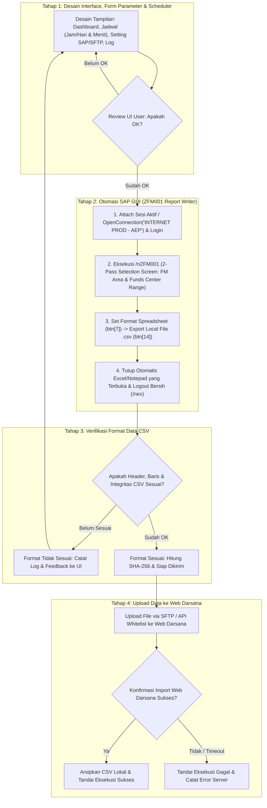

# ISSUE: Spesifikasi Lengkap & Master Blueprint Aplikasi Bot Atlaz (Ekstraksi Data SAP ZFM001 & Sinkronisasi Web Darsana)

## 1. Metadata Dokumen
- **Nama Proyek:** Atlaz
- **Deskripsi Proyek:** Desktop Bot Otomasi Ekstraksi SAP GUI (`ZFM001` - *Report FM for AirNav 2024*) ke CSV & Sinkronisasi Data ke Web Darsana (Laravel Dashboard).
- **Platform Saat Ini:** Windows Desktop (.NET 8 / WPF - MVVM, Self-Contained `win-x64`).
- **Sifat Dokumen:** *Master Blueprint & Cross-Platform Specification*. Dokumen ini merangkum seluruh aturan bisnis, alur UI, parameter form, ID elemen SAP GUI Scripting, mekanisme penutupan aplikasi peninjau CSV otomatis, penjadwalan dinamis, hingga struktur data agar aplikasi dapat dibangun ulang (*rebuild*) atau di-porting ke bahasa/platform apa pun (C#, Python, Node.js/Electron, Go, Rust, VBScript) tanpa kehilangan konteks sedikit pun.
- **Metode Pengembangan:** 4 Tahapan Bertahap (*Phase-Gated Development Roadmap*).
- **Status Saat Ini:** Tahap 1 & Tahap 2 Selesai dan Teruji di Server Produksi SAP (`INTERNET PROD - AEP`). Siap memasuki Tahap 3 & 4.

---

## 2. Latar Belakang & Masalah

### 2.1 Kondisi Eksisting
1. Proses penarikan data realisasi anggaran berkala dari SAP dilakukan melalui SAP GUI menggunakan transaksi kustom **`ZFM001`** (*Report FM for AirNav 2024*), yang merupakan laporan berbasis **SAP Report Writer / Report Painter** dan menghasilkan output file `.csv`.
2. File CSV tersebut selanjutnya dikirimkan ke aplikasi web dashboard **Web Darsana** (berbasis Laravel) yang berjalan di shared hosting (Hostinger/cPanel).
3. Pada generasi bot lama, pengiriman HTTP langsung terblokir **HTTP 403 Forbidden** oleh proteksi Web Application Firewall (WAF) **Imunify360** pada level hosting.

### 2.2 Batasan Desain & Kebijakan Kepatuhan (Anti-Bypass Policy)
> [!IMPORTANT]
> **Kebijakan Keamanan:**
> Dilarang keras mengimplementasikan teknik *scraping*, manipulasi browser headless siluman, spoofing User-Agent/header peretas, atau trik bypass proteksi WAF Imunify360. Pengiriman data harus menggunakan jalur resmi dan terverifikasi yang didukung dan diizinkan oleh arsitektur hosting.

Aplikasi memisahkan secara tegas (*strict separation of concerns*) antara:
1. **Engine Otomasi SAP GUI:** Khusus koneksi/attach sesi, login otomatis, eksekusi transaksi `ZFM001` (2-pass Report Writer), ekspor CSV lokal, penutupan paksa Excel/viewer yang terbuka otomatis, dan logout bersih.
2. **Engine Validasi Data:** Memeriksa kesesuaian kolom header realisasi anggaran, delimiter, jumlah baris, dan checksum SHA-256 sebelum dikirim.
3. **Engine Transfer & Sinkronisasi:** Saluran komunikasi resmi (SFTP / API Whitelist) ke Web Darsana.

---

## 3. Analisis Saluran Transfer Data ke Web Darsana (Hosting Compliant)

Sebelum menetapkan implementasi pengiriman pada Tahap 4, rujuk opsi transfer legal yang didukung lingkungan Hostinger/cPanel:

| Opsi Jalur | Mekanisme Teknis | Toleransi Imunify360 | Kebutuhan Konfigurasi Server | Rekomendasi |
| :--- | :--- | :--- | :--- | :--- |
| **Opsi A: SFTP / FTPS (Terisolasi)** | File diunggah langsung ke direktori aman cPanel (`storage/app/import_staging`) via SSH/SFTP dengan akun kredensial terpisah. Web Darsana membaca file via cron/job worker. | **Sangat Aman** (Tidak melalui port 80/443 HTTP layer, sehingga tidak diinspeksi oleh WAF Imunify360 HTTP rules). | Buat akun FTP/SFTP terbatas hanya ke folder staging. Pasang Laravel Artisan command/scheduler di Web Darsana untuk memproses file masuk. | **Prioritas 1 (Sangat Disarankan)** |
| **Opsi B: REST API Resmi + IP Whitelist** | Desktop bot mengirim payload CSV/JSON melalui API endpoint berotentikasi (Laravel Sanctum token). IP publik PC/Server kantor didaftarkan di whitelist Imunify360 cPanel. | **Aman jika di-whitelist** (Jika IP kantor statis, admin hosting dapat memasukkan IP ke *Imunify360 White List*). | Administrator memasukkan IP keluar bot ke Whitelist cPanel Imunify360 + generate API Token. | **Prioritas 2 (Alternatif jika IP statis)** |
| **Opsi C: Cloud Storage Relay (S3 / Google Drive)** | Bot upload file ke bucket S3 / Cloud Storage, kemudian memanggil webhook ringan Web Darsana untuk memberitahu nama file yang siap ditarik server. | **Sangat Aman** (Traffic web hosting hanya memanggil API S3, bot tidak posting file besar ke hosting langsung). | Butuh akun Cloud Provider (AWS S3, Google Cloud, atau R2 Cloudflare). | **Prioritas 3 (Jika SFTP ditolak)** |

---

## 4. Alur Kerja Sistem Berbasis 4 Tahap (Workflow Diagram)



---

## 5. Spesifikasi Detail 4 Tahap Pengembangan (Master Blueprint)

```
┌────────────────────────────────────────────────────────────────────────┐
│ TAHAP 1: Desain Interface, Konfigurasi Parameter & Mesin Penjadwalan   │
│ └── Target: Dashboard, Scheduler (Jam/Hari & N-Menit), Settings, Log.  │
│ └── STATUS: SELESAI & DISETUJUI                                        │
├────────────────────────────────────────────────────────────────────────┤
│ TAHAP 2: Otomasi SAP GUI (ZFM001 Report Writer, Export CSV, Auto-Close)│
│ └── Target: Ekspor CSV utuh dari ZFM001 + tutup Excel otomatis.        │
│ └── STATUS: SELESAI & TERUJI DI SERVER SAP                             │
├────────────────────────────────────────────────────────────────────────┤
│ TAHAP 3: Verifikasi Format Data CSV                                    │
│ └── Target: Cek 14 kolom header ZFM001, isi baris, checksum SHA-256.   │
│ └── GERBANG 3: Valid ──> Lanjut Tahap 4 | Belum ──> Balik ke Tahap 1   │
├────────────────────────────────────────────────────────────────────────┤
│ TAHAP 4: Upload Data ke Web Darsana                                    │
│ └── Target: Pengiriman aman (SFTP/API) & verifikasi import sukses.     │
│ └── GERBANG 4: Data ter-import di Web Darsana & Audit Log Sukses.      │
└────────────────────────────────────────────────────────────────────────┘
```

---

### Tahap 1: Desain Interface, Form Parameter SAP & Mesin Penjadwalan

#### 1.1 Komponen Layar (4 Navigasi Utama)
1. **📊 Dashboard Eksekusi:**
   - **Kartu Status:** Status Mesin Bot (`IDLE`, `RUNNING`, `SUCCESS`, `ERROR`), Eksekusi Terakhir (`dd MMM yyyy, HH:mm:ss`), Jadwal Berikutnya (terhitung otomatis dari timer aktif), dan File Terakhir (`nama_file.csv` beserta jumlah baris).
   - **Tombol Aksi Utama:**
     - `▶ RUN MANUAL SEKARANG`: Memicu alur eksekusi langsung.
     - `🔍 Cek Kesiapan SAP`: Menjalankan diagnostik 4 langkah koneksi COM SAP GUI secara instan dan menampilkan hasilnya di kotak pesan umpan balik.
     - `⏹ HENTIKAN PROSES`: Membatalkan proses yang sedang berjalan.
   - **Visualisasi Pipeline 4 Tahap:** Indikator progres langkah 1 s/d 4 beserta *progress bar* persentase dan log umpan balik (*feedback message*) real-time.
   - **Tabel Aktivitas Terbaru:** Ringkasan 5 eksekusi terakhir.

2. **⏰ Pengaturan Jadwal (Scheduler View) — 2 Mode Dinamis:**
   - Toggle Switch Master: **Aktifkan Penjadwalan Otomatis** (`IsScheduleEnabled`).
   - Pilihan Mode Frekuensi (`ScheduleIntervalType` via RadioButton):
     - **Mode 1: `📅 Jadwal Tiap Jam / Hari Tertentu` (`Hourly`)**
       - Menampilkan input **Waktu Eksekusi Harian (Jam : Menit)** dalam format `HH:mm` (misal `06:00`).
       - Menampilkan kartu **Hari Kerja Aktif** berisi 7 Checkbox hari (`Senin`, `Selasa`, `Rabu`, `Kamis`, `Jumat`, `Sabtu`, `Minggu`).
       - Bot hanya akan mengeksekusi otomatis apabila hari ini dicentang dan jam sistem mencapai `HH:mm` yang ditentukan (maksimal 1 kali per hari pada jam tersebut).
     - **Mode 2: `⚡ Update Tiap Berapa Menit (Uji Coba Cepat)` (`EveryNMinutes`)**
       - Menyembunyikan pilihan hari dan menampilkan input **Interval Menit** (`IntervalMinutes`, misal `1`, `5`, `10`, `30` menit).
       - Dirancang khusus untuk kebutuhan **uji coba sistem (*system testing*)** atau pemantauan intensif.
       - Saat diaktifkan atau diubah nilainya, timer background (interval pengecekan tiap 10 detik) langsung menghitung mundur `Now + IntervalMinutes` dan mengeksekusi pipeline secara berulang setiap $N$ menit.

3. **⚙️ Pengaturan & Kredensial (Settings View):**
   - **Bagian 1: Kredensial & Parameter SAP GUI (`ZFM001`)**
     | Nama Field di UI | Properti Model | Nilai Default | Keterangan Penting |
     | :--- | :--- | :--- | :--- |
     | **Connection Description (SAP Logon)** | `SapSystemId` | `INTERNET PROD - AEP` | **Wajib berisi Description persis di SAP Logon**, bukan System ID 3 huruf (`AEP`). |
     | **Client** | `SapClient` | `100` | Nomor client SAP (`RSYST-MANDT`). |
     | **Username SAP** | `SapUsername` | *(diisi user)* | Username login SAP (`RSYST-BNAME`). |
     | **Password SAP** | `SapPassword` | *(diisi user)* | Password login SAP (`RSYST-BCODE`). |
     | **Transaction Code** | `SapTransaction` | `ZFM001` | Kode transaksi laporan realisasi anggaran. |
     | **FM Area** | `SapFmArea` | `1000` | Parameter wajib Financial Management Area. |
     | **Budget Category** | `SapBudgetCategory` | `9F` | Payment (default `9F`). |
     | **Version** | `SapVersion` | `0` | Versi anggaran (default `0`). |
     | **Fiscal Year** | `SapFiscalYear` | `2026` | Tahun anggaran berjalan. |
     | **From Period** | `SapPeriodFrom` | `1` | Periode awal (bulan `1`). |
     | **To Period** | `SapPeriodTo` | `12` | Periode akhir (bulan `12`). |
     | **Funds Center (From)** | `SapFundsCenter` | `A022020000` | Batas awal (*Low*) Pusat Dana (`_4FFICTR-LOW`). |
     | **Funds Center (To)** | `SapFundsCenterTo` | `A022020005` | Batas akhir (*High*) Pusat Dana (`_4FFICTR-HIGH`). |
     | **Commitment Item (Or value)** | `SapCommitmentItem` | *(kosong/opsional)* | Filter pos anggaran bila diperlukan. |
   - **Bagian 2: Konfigurasi Transfer SFTP Web Darsana (Compliant)**
     - `SftpHost` (`darsana.co.id`), `SftpPort` (`22`), `SftpUsername`, `SftpPassword`, `SftpRemoteStagingPath` (`/home/user/webdarsana/storage/app/import_staging`), dan `LocalExportFolder` (`C:\AtlazData\exports`).
   - **Persistensi Konfigurasi:**
     - Seluruh pengaturan disimpan ke file JSON lokal (`%LocalAppData%\Atlaz\config.json`) setiap kali tombol **Simpan Seluruh Pengaturan** ditekan, dan dimuat otomatis saat aplikasi dibuka.

4. **📜 Riwayat & Log Eksekusi (Log Viewer):**
   - Tabel riwayat lengkap dengan kolom: `Waktu Eksekusi`, `Nama File CSV`, `Baris`, `Tahap Terakhir`, `Status`, dan `Pesan / Detail Log`.

---

### Tahap 2: Otomasi SAP GUI (Spesifikasi Teknis & ID Elemen Lengkap)

> [!WARNING]
> **Temuan Kritis Produksi (Jangan Diubah Saat Porting/Rebuild):**
> 1. **Description vs System ID:** Fungsi `application.OpenConnection(description, true)` pada SAP GUI Scripting membutuhkan **Description** lengkap yang tertera di daftar SAP Logon (contoh: `"INTERNET PROD - AEP"`), bukan System ID 3 huruf (`"AEP"`).
> 2. **ZFM001 Adalah Transaksi Report Writer (`SAPLGRWOS`), Bukan ALV Grid Biasa:** Perintah `/n%PC` atau menu ALV standar menghasilkan data yang tidak terbaca penuh. Ekspor **wajib** mengikuti alur 2-pass seleksi + tombol `btn[7]` (Spreadsheet) + tombol `btn[14]` (Export Local File) seperti tercantum di bawah ini.
> 3. **Dilarang Membuat File CSV Dummy/Fallback:** Jika koneksi atau ekspor SAP gagal, bot harus melempar error (`Success = false`) agar operator tahu penyebab aslinya.

#### 2.1 Diagnostik Kesiapan SAP (`Diagnose()`)
Memeriksa 4 syarat berurutan:
1. Registrasi COM `SapROTWr.SapROTWrapper` di Windows Registry.
2. Keberadaan proses `saplogon.exe` di memori (jika belum jalan, jalankan dari `C:\Program Files (x86)\SAP\FrontEnd\SAPgui\saplogon.exe` atau `C:\Program Files\SAP\FrontEnd\SAPgui\saplogon.exe`).
3. Pengambilan objek `GetROTEntry("SAPGUI")` (dengan mekanisme *retry* hingga 5 kali jeda 1,5 detik).
4. Pemanggilan `GetScriptingEngine` berhasil mengembalikan objek `GuiApplication`.

#### 2.2 Koneksi & Smart Auto-Login
1. **Mode Attach (Prioritas 1):**
   - Cek apakah `application.Children.Count > 0`. Jika sudah ada koneksi dan sesi terbuka (`connection.Children.Count > 0`), langsung gunakan `session` tersebut.
2. **Mode OpenConnection (Jika Belum Ada Sesi):**
   - Panggil `application.OpenConnection(SapSystemId, true)`.
   - Ambil `session = connection.Children(0)`.
3. **Deteksi Layar Login (`wnd[0]/usr/txtRSYST-BNAME`):**
   - Cek apakah elemen `wnd[0]/usr/txtRSYST-BNAME` ada di layar.
   - **Jika tidak ada:** Berarti sesi yang di-*attach* sudah dalam keadaan login. Lewati proses pengisian password (`botLoggedIn = false`).
   - **Jika ada:** Isi kredensial login (`botLoggedIn = true`):
     - `wnd[0]/usr/txtRSYST-MANDT.text = SapClient`
     - `wnd[0]/usr/txtRSYST-BNAME.text = SapUsername`
     - `wnd[0]/usr/pwdRSYST-BCODE.text = SapPassword`
     - `wnd[0]/usr/txtRSYST-LANGU.text = "EN"`
     - Kirim `wnd[0].sendVKey(0)` (Enter).
   - **Penanganan Popup Multiple Logon:**
     - Jika muncul `wnd[1]` dengan `wnd[1]/usr/radMULTI_LOGON_OPT1`, pilih radio button tersebut lalu tekan `wnd[1]/tbar[0]/btn[0]`.
   - **Verifikasi Pasca-Login:**
     - Jika setelah Enter elemen `wnd[0]/usr/txtRSYST-BNAME` masih ada di layar, hentikan proses dan laporkan error: *"Masih di layar login SAP — kemungkinan Username / Password / Client salah."*

#### 2.3 Eksekusi Transaksi `ZFM001` & Alur 2-Pass Report Writer
1. Maksimalkan jendela: `wnd[0].maximize()`.
2. Buka transaksi via OK Code:
   - `wnd[0]/tbar[0]/okcd.text = "/n" + SapTransaction` (default `/nZFM001`)
   - `wnd[0].sendVKey(0)`
3. **Penanganan Popup Peringatan Otorisasi/Maintain:**
   - Jika muncul popup informasi (seperti *"Username/Funds center anda belum di maintain"*), tekan `wnd[1]/tbar[0]/btn[0]` untuk melanjutkan.
4. **Layar Seleksi — PASS 1:**
   - Isi **FM Area**: `wnd[0]/usr/ctxt$4FFIKRS.text = SapFmArea` (fallback ke `wnd[0]/usr/ctxtP_FIKRS`).
   - Isi **Funds Center Low (From)**: `wnd[0]/usr/ctxt_4FFICTR-LOW.text = SapFundsCenter` (fallback ke `wnd[0]/usr/ctxtS_FICTR-LOW`).
   - Isi **Funds Center High (To)**: `wnd[0]/usr/ctxt_4FFICTR-HIGH.text = SapFundsCenterTo` (fallback ke `wnd[0]/usr/ctxtS_FICTR-HIGH`).
   - Set fokus & posisi kursor pada `_4FFICTR-HIGH` (`caretPosition = length`), lalu tekan Execute: `wnd[0].sendVKey(8)` (F8).
   - *(Opsional)* Jika field parameter tambahan tersedia di layar (`ctxtP_BLCAT`, `ctxtP_VERSN`, `ctxtP_GJAHR`, `ctxtP_PERIO1`, `ctxtP_PERIO2`), isi sesuai konfigurasi tanpa menggagalkan proses bila field tersebut disembunyikan varian.
5. **Layar Seleksi — PASS 2 (Karakteristik ZFM001):**
   - Isi kembali field `wnd[0]/usr/ctxt$4FFIKRS`, `wnd[0]/usr/ctxt_4FFICTR-LOW`, dan `wnd[0]/usr/ctxt_4FFICTR-HIGH` dengan nilai yang sama.
6. **Atur Tipe Output ke Spreadsheet (`btn[7]`):**
   - Tekan tombol pengaturan output: `wnd[0]/tbar[1]/btn[7].press()`
   - Pada dialog `wnd[1]`, fokuskan ke combo box tipe file: `wnd[1]/usr/subOI_DOC_TYPE:SAPLGRWOS:0210/cmbGRWOS_S_SCREEN_FIELDS-FILE_TYPE.setFocus()`
   - Konfirmasi dialog: `wnd[1]/tbar[0]/btn[0].press()`
   - Jalankan laporan (Execute F8): `wnd[0].sendVKey(8)`

#### 2.4 Ekspor ke Local File CSV (`btn[14]`)
1. Siapkan nama file bertanggal di `LocalExportFolder`:
   - Format: `realisasi_{yyyyMMdd_HHmm}_{SapTransaction}.csv` (contoh: `realisasi_20261017_0730_ZFM001.csv`).
   - Jika file dengan nama yang sama sudah ada, hapus terlebih dahulu agar tidak tertahan popup overwrite.
2. Tekan tombol Export pada toolbar aplikasi:
   - `wnd[0]/tbar[1]/btn[14].press()`
3. Pada dialog penyimpanan `wnd[1]`, masukkan path lengkap beserta nama file `.csv`:
   - `wnd[1]/usr/ctxtLGRWO-OUT_FILE.text = fullFilePath`
   - `wnd[1]/usr/ctxtLGRWO-OUT_FILE.setFocus()`
   - `wnd[1]/usr/ctxtLGRWO-OUT_FILE.caretPosition = fullFilePath.Length`
   - Tekan tombol OK/Continue: `wnd[1]/tbar[0]/btn[0].press()`
4. **Konfirmasi Popup Keamanan / Overwrite SAP GUI (`SPOP`):**
   - Tekan `wnd[2]/usr/btnSPOP-VAROPTION2.press()` (jika `wnd[2]` muncul).
   - Tekan `wnd[1]/usr/btnSPOP-VAROPTION1.press()` (jika `wnd[1]` muncul).
5. **Verifikasi Penulisan File di Disk:**
   - Tunggu hingga file benar-benar ada di disk dan ukurannya $> 0$ byte (polling hingga 10 kali dengan jeda 500 ms).

#### 2.5 Penutupan Otomatis Aplikasi Viewer CSV (`CloseExportedCsvViewer`)
> [!TIP]
> **Mengapa Fitur Ini Wajib Ada:**
> Karena pada langkah 2.3 digunakan mode *Spreadsheet* (`SAPLGRWOS`), SAP GUI secara otomatis membuka file `.csv` hasil ekspor menggunakan Microsoft Excel (atau Notepad) begitu ekspor selesai. Jika tidak ditutup oleh bot, proses Excel akan mengunci file (*file lock*) dan menumpuk puluhan jendela Excel di server setiap kali jadwal berjalan.

- Setelah file terverifikasi di disk (beri jeda ~800 ms agar proses viewer sempat muncul), cari seluruh proses `EXCEL`, `notepad`, atau `scalc` yang sedang berjalan.
- Periksa `MainWindowTitle` dari masing-masing proses. Jika judul jendela mengandung nama file yang baru saja diekspor (`fileName` atau `fileNameWithoutExt`):
  1. Kirim sinyal `CloseMainWindow()` dan tunggu hingga 1.500 ms.
  2. Jika proses masih belum tertutup, panggil `Kill()` pada proses tersebut.

#### 2.6 Logout Bersih & Pelepasan COM
- Jika sesi dibuat oleh bot (`botLoggedIn == true`), kirim `/n` lalu `/nex` pada `wnd[0]/tbar[0]/okcd` untuk menutup sesi SAP GUI.
- Lepaskan referensi COM (`Marshal.ReleaseComObject`) pada blok `finally`.

---

### Tahap 3: Verifikasi Format Data CSV

#### 3.1 Struktur Asli File CSV Hasil Ekspor `ZFM001`
Berdasarkan hasil ekspor riil dari server SAP AirNav, file CSV memiliki karakteristik berikut:
- **Baris Header Metadata Awal:** Beberapa baris pertama berisi judul laporan (`Report FM for AirNav 2024`, `Fiscal Year`, `Period`, dll.).
- **Baris Header Tabel Utama (14 Kolom):**
  1. `Funds Center/Commitment Item` (Berisi kode dan deskripsi hirarki Pusat Dana / Pos Anggaran, contoh: `* A022020000 PERUM LPPNPI`, `51010101 GAJI POKOK`)
  2. `RKAP`
  3. `BudgetRelease`
  4. `BudgetSender`
  5. `BudgetReceiver`
  6. `BudgetSupplement`
  7. `Return`
  8. `Commitment`
  9. `Actual`
  10. `Total Consume`
  11. `Available Budget`
  12. `Not Release Budget`
  13. `% Realisasi`
  14. `% Total Cosume` *(catatan: ejaan asli dari SAP adalah `Cosume` tanpa huruf 'n')*

#### 3.2 Kriteria Validasi (`CsvFileValidationService`)
1. **Eksistensi & Ukuran:** File ada di disk dan ukuran $> 0$ byte.
2. **Keberadaan Kolom Kunci:** Memastikan terdapat baris header atau data yang memuat struktur laporan `ZFM001` (minimal 2 baris non-kosong dan mengandung delimiter `,`, `;`, atau `\t`).
3. **Perhitungan Checksum SHA-256:** Menghitung nilai hash SHA-256 dari file CSV untuk dicatat di log audit dan diverifikasi saat pengiriman ke Web Darsana.

---

### Tahap 4: Upload Data ke Web Darsana
1. **Pengiriman File Aman (Compliant Transfer):**
   - Mengunggah file CSV yang telah lolos validasi Tahap 3 ke server Web Darsana melalui **SFTP (`SSH.NET`)** menuju direktori staging (`storage/app/import_staging`) atau melalui endpoint API resmi yang telah di-whitelist di Imunify360.
2. **Verifikasi Import & Pengarsipan:**
   - Memastikan pengiriman sukses tanpa error HTTP 403.
   - Memindahkan/menyalin file CSV lokal ke arsip dan memperbarui riwayat eksekusi di UI dengan status `SUCCESS`.

---

## 6. Struktur Direktori Solusi .NET (Arsitektur Saat Ini)

```
Atlaz/
├── Atlaz.sln
├── build_installer.ps1                  # Script otomasi publish win-x64, Zip Portable & Inno Setup
├── issue.md                             # Dokumen Master Blueprint ini
├── installer/
│   ├── setup.iss                        # Konfigurasi Inno Setup Compiler
│   ├── Atlaz_Setup_v1.0.exe             # Installer Windows
│   └── Atlaz_Server_Portable_v1.0.zip   # Paket Portable (Tanpa Install, tinggal ekstrak)
└── src/
    ├── Atlaz.Core/                      # Domain Models & Interfaces
    │   ├── Interfaces/
    │   │   ├── ISapAutomationService.cs        # Kontrak Tahap 2 (+ Diagnose)
    │   │   ├── ICsvValidationService.cs        # Kontrak Tahap 3
    │   │   └── ITransferService.cs             # Kontrak Tahap 4
    │   └── Models/
    │       └── CoreModels.cs                   # AppConfig, ScheduleIntervalType, ExecutionLog, dll.
    │
    ├── Atlaz.Infrastructure/            # Implementasi Layanan Teknis
    │   ├── Sap/
    │   │   └── SapGuiAutomationService.cs      # Tahap 2: COM Interop ZFM001 + Auto-Close Excel
    │   ├── Validation/
    │   │   └── CsvFileValidationService.cs     # Tahap 3: Validasi CSV & SHA-256
    │   └── Transfer/
    │       └── SftpTransferService.cs          # Tahap 4: SFTP Transfer
    │
    └── Atlaz.UI/                        # Tahap 1: Presentasi WPF (MVVM)
        ├── ViewModels/
        │   └── MainViewModel.cs                # State Machine 4-Tahap, DispatcherTimer Scheduler, Persistensi JSON
        ├── Converters/
        │   └── InverseBoolConverter.cs
        ├── MainWindow.xaml                     # UI Utama (Dashboard, Scheduler, Settings, Log)
        └── App.xaml
```

---

## 7. Panduan Porting Lintas Bahasa / Platform (Section Khusus Rebuild)

Apabila di masa mendatang Anda ingin membangun ulang aplikasi **Atlaz** menggunakan bahasa pemrograman lain (seperti **Python**, **Node.js / Electron**, **Go**, atau **Rust**), gunakan tabel pemetaan teknis berikut sebagai acuan mutlak:

### 7.1 Pemetaan Library per Bahasa Pemrograman
| Komponen Fitur | C# (.NET 8 - Saat Ini) | Python (Alternatif Populer) | Node.js / Electron | Go (Golang) |
| :--- | :--- | :--- | :--- | :--- |
| **COM Interop SAP GUI** | `Type.GetTypeFromProgID("SapROTWr.SapROTWrapper")` | `win32com.client.GetObject("SAPGUI")` (`pywin32`) | `winax` (`new ActiveXObject("SapROTWr.SapROTWrapper")`) | `github.com/go-ole/go-ole` |
| **Desktop UI** | WPF (XAML + MVVM) | PyQt6 / CustomTkinter / Flet | Electron + React / Vue | Wails / Fyne |
| **Background Scheduler** | `DispatcherTimer` (tick 10 detik) | `APScheduler` / `schedule` | `node-cron` / `setInterval` | `robfig/cron` / `time.Ticker` |
| **Penutup Proses Excel** | `System.Diagnostics.Process.GetProcessesByName("EXCEL")` | `psutil.process_iter()` + `win32gui` | `taskkill /FI "WINDOWTITLE eq ...*"` | `os/exec` (`taskkill`) / Win32 API |
| **SFTP Client** | `SSH.NET` (`Renci.SshNet`) | `paramiko` / `pysftp` | `ssh2-sftp-client` | `github.com/pkg/sftp` |

### 7.2 Urutan Perintah COM SAP GUI (`ZFM001`) yang Wajib Sama Persis di Semua Bahasa
Urutan pemanggilan method/property objek `session` SAP GUI Scripting tidak bergantung pada bahasa pemrograman:

```text
1. session.findById("wnd[0]").maximize()
2. session.findById("wnd[0]/tbar[0]/okcd").text = "/nZFM001"
3. session.findById("wnd[0]").sendVKey(0)

-- PASS 1 --
4. session.findById("wnd[0]/usr/ctxt$4FFIKRS").text = fmArea          // "1000"
5. session.findById("wnd[0]/usr/ctxt_4FFICTR-LOW").text = ficLow      // "A022020000"
6. session.findById("wnd[0]/usr/ctxt_4FFICTR-HIGH").text = ficHigh    // "A022020005"
7. session.findById("wnd[0]/usr/ctxt_4FFICTR-HIGH").setFocus()
8. session.findById("wnd[0]/usr/ctxt_4FFICTR-HIGH").caretPosition = len(ficHigh)
9. session.findById("wnd[0]").sendVKey(8)                             // Execute Pass 1

-- PASS 2 --
10. session.findById("wnd[0]/usr/ctxt$4FFIKRS").text = fmArea
11. session.findById("wnd[0]/usr/ctxt_4FFICTR-LOW").text = ficLow
12. session.findById("wnd[0]/usr/ctxt_4FFICTR-HIGH").text = ficHigh
13. session.findById("wnd[0]/usr/ctxt_4FFICTR-HIGH").setFocus()
14. session.findById("wnd[0]/usr/ctxt_4FFICTR-HIGH").caretPosition = len(ficHigh)

-- SET SPREADSHEET & EXECUTE --
15. session.findById("wnd[0]/tbar[1]/btn[7]").press()
16. session.findById("wnd[1]/usr/subOI_DOC_TYPE:SAPLGRWOS:0210/cmbGRWOS_S_SCREEN_FIELDS-FILE_TYPE").setFocus()
17. session.findById("wnd[1]/tbar[0]/btn[0]").press()
18. session.findById("wnd[0]").sendVKey(8)                            // Execute Report

-- EXPORT KE FILE CSV LOKAL --
19. session.findById("wnd[0]/tbar[1]/btn[14]").press()
20. session.findById("wnd[1]/usr/ctxtLGRWO-OUT_FILE").text = fullCsvPath
21. session.findById("wnd[1]/usr/ctxtLGRWO-OUT_FILE").setFocus()
22. session.findById("wnd[1]/usr/ctxtLGRWO-OUT_FILE").caretPosition = len(fullCsvPath)
23. session.findById("wnd[1]/tbar[0]/btn[0]").press()

-- KONFIRMASI POPUP KEAMANAN / OVERWRITE (BILA MUNCUL) --
24. session.findById("wnd[2]/usr/btnSPOP-VAROPTION2").press()         // Abaikan jika tidak muncul
25. session.findById("wnd[1]/usr/btnSPOP-VAROPTION1").press()         // Abaikan jika tidak muncul

-- PASCA EKSPOR --
26. Tunggu 1.500 ms -> Verifikasi file CSV ada di disk dan ukuran > 0 byte.
27. Cari proses EXCEL.EXE / notepad.exe yang membuka nama file CSV tersebut -> Tutup jendelanya.
28. Jika bot yang melakukan login di awal, jalankan "/n" lalu "/nex" untuk logout.
```

---

## 8. Kriteria Penerimaan & Status Saat Ini (Acceptance Criteria)

### Tahap 1: Desain Interface & Penjadwalan
- [x] Antarmuka WPF menampilkan Dashboard, Pengaturan Jadwal, Konfigurasi Akun, dan Riwayat Log.
- [x] Form konfigurasi SAP memuat seluruh parameter `ZFM001` termasuk range **Funds Center (From – To)**.
- [x] Fitur Penjadwalan mendukung 2 mode: **Jadwal Tiap Jam / Hari Tertentu** (dengan pilihan hari Senin–Minggu) dan **Update Tiap Berapa Menit** (untuk uji coba cepat).
- [x] Pengaturan tersimpan otomatis secara persisten di `%LocalAppData%\Atlaz\config.json`.

### Tahap 2: Otomasi SAP GUI
- [x] Implementasi late-binding COM SAP GUI Scripting Engine (`SapGuiAutomationService`).
- [x] Tombol diagnostik **"🔍 Cek Kesiapan SAP"** dengan pengecekan 4 langkah & retry ROT entry.
- [x] Mendukung mode *Attach* ke sesi SAP yang sedang aktif maupun *OpenConnection* otomatis menggunakan Description `INTERNET PROD - AEP`.
- [x] Eksekusi `ZFM001` menggunakan alur 2-pass Report Writer (`ctxt$4FFIKRS`, `ctxt_4FFICTR-LOW`, `ctxt_4FFICTR-HIGH`, `btn[7]`, `btn[14]`, `ctxtLGRWO-OUT_FILE`) sesuai acuan VBScript produksi.
- [x] Menutup otomatis file CSV yang terbuka di Excel/Notepad setelah ekspor selesai (`CloseExportedCsvViewer`).
- [x] Sesi SAP GUI ditutup dan di-logout secara bersih jika bot yang melakukan login awal.

### Tahap 3: Verifikasi Format Data CSV
- [ ] Penyesuaian validator CSV dengan 14 kolom header riil `ZFM001` AirNav (`Funds Center/Commitment Item`, `RKAP`, `BudgetRelease`, dst.) dan checksum SHA-256.
- [ ] Pengujian alur berhenti otomatis jika file tidak valid.

### Tahap 4: Upload Data ke Web Darsana
- [ ] Pengiriman file CSV ke server Web Darsana via SFTP (`SSH.NET`) atau API resmi yang di-whitelist tanpa terkena blokir HTTP 403 Imunify360.
- [ ] Verifikasi import di Web Darsana dan pengarsipan file CSV lokal.

---

## 9. Catatan Teknis & Troubleshooting Log

### 9.1 Kendala: "Gagal mendapatkan entri ROT SAPGUI"
- **Penyebab:** Objek COM `SapROTWr.SapROTWrapper` terdaftar, tetapi fungsi `GetROTEntry("SAPGUI")` menghasilkan `null`.
- **Solusi:**
  1. Gunakan tombol **"🔍 Cek Kesiapan SAP"** di Dashboard.
  2. Pastikan opsi *Scripting* di SAP Logon telah dicentang: **SAP Logon** -> **Options** -> **Accessibility & Scripting** -> **Scripting** -> Centang **"Enable scripting"** (dan hilangkan centang *"Notify when a script attaches to SAP GUI"* serta *"Notify when a script opens a connection"* agar tidak muncul popup blokir).
  3. Samakan level hak akses (*run level*): jalankan SAP Logon dan Atlaz dengan hak akses pengguna yang setara (hindari satu Administrator dan satu Non-Administrator).

### 9.2 Kendala: Koneksi SAP Gagal Saat Menggunakan System ID 3 Huruf (`AEP`)
- **Penyebab:** `OpenConnection` pada SAP GUI Scripting mencari nama koneksi berdasarkan kolom **Description** di SAP Logon Pad, bukan kolom System ID.
- **Solusi:** Isi field **Connection Description** dengan nama lengkap persis seperti di SAP Logon, yaitu `INTERNET PROD - AEP`.

### 9.3 Kendala: Hasil Ekspor CSV Tidak Terbaca Utuh / Berbeda dari Manual
- **Penyebab:** Transaksi `ZFM001` menggunakan modul Report Writer (`SAPLGRWOS`), sehingga ekspor tidak bisa menggunakan perintah standar `/n%PC` melainkan harus memilih tipe output Spreadsheet (`tbar[1]/btn[7]`) sebelum mengeksekusi laporan, lalu menekan tombol Export (`tbar[1]/btn[14]`) dan mengisi `ctxtLGRWO-OUT_FILE` dengan ekstensi `.csv`.
- **Solusi:** Telah diimplementasikan secara penuh pada `SapGuiAutomationService.cs` mengacu pada skrip `export_sap.vbs`.

### 9.4 Rilis & Distribusi Portable
- Setiap perubahan kode dikompilasi menjadi paket mandiri (*self-contained* `win-x64`) dan dipublikasikan ke GitHub Release:
  - **Repository:** `https://github.com/kknida/atlaz`
  - **Direct Download Portable ZIP:** `https://github.com/kknida/atlaz/releases/download/v1.0.0/Atlaz_Server_Portable_v1.0.zip`
